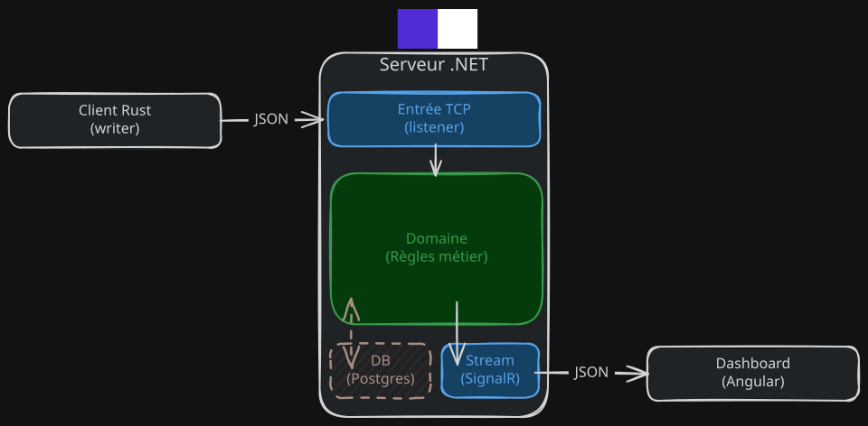

# Roomers

Une salle de classe virtuelle en temps réel. Le professeur lance son cours, la salle se ferme, un dashboard montre qui est là en direct.

Projet perso, construit sans IA, pour apprendre (.NET, SignalR, Angular, Rust) et voir une machine à états tourner pour de vrai.

## L'idée

- Les étudiants et le professeur entrent dans une salle.
- Le professeur lance son cours pour une durée donnée. Une fois lancé, plus personne ne peut entrer.
- Un étudiant peut partir quand il veut.
- À la fin du cours, les étudiants sortent automatiquement. Le professeur reste et peut relancer une session.
- Un client envoie des événements, un serveur applique les règles, un dashboard affiche l'état.

## Architecture



En pointillés : prévu, pas encore implémenté.

## Stack

| Partie | Techno |
|---|---|
| Serveur | .NET, `TcpListener`, SignalR |
| Dashboard | Angular |
| Client | Rust |
| Tests | xUnit |

## Le protocole en 30 secondes

Une ligne JSON par événement, en TCP. Pas de réponse : le serveur décide.

| `type` | Sens |
|---|---|
| `student_joined` / `student_left` | un étudiant entre / sort |
| `student_active` | heartbeat |
| `teacher_joined` / `teacher_left` | le professeur entre / sort |
| `class_started` | le professeur lance le cours (`duration_seconds`) |

```json
{ "type": "class_started", "teacher_id": "t-1", "room_id": "room-1", "timestamp": 1708455600, "duration_seconds": 3600 }
```

Détails dans [docs/protocol.md](docs/protocol.md).

## Lancer les tests

```sh
dotnet test
```
